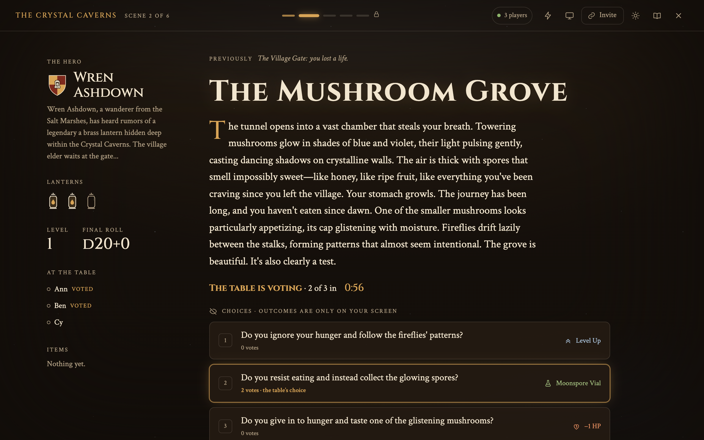
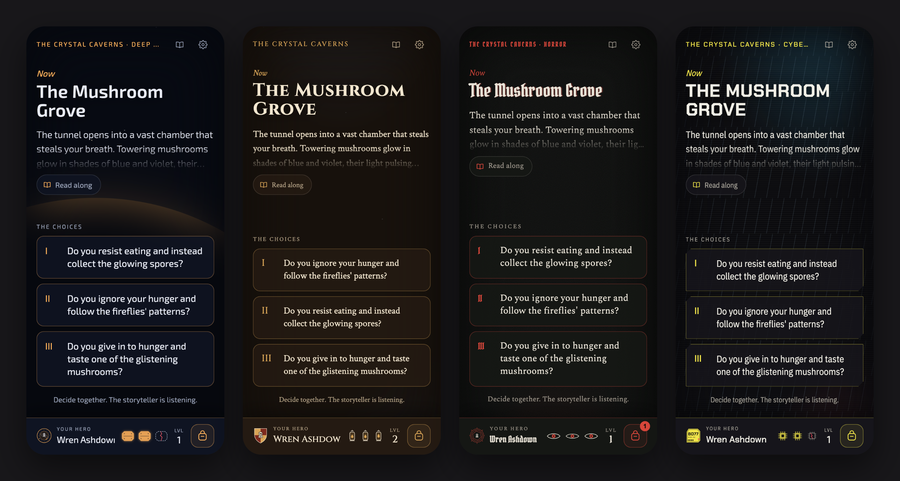
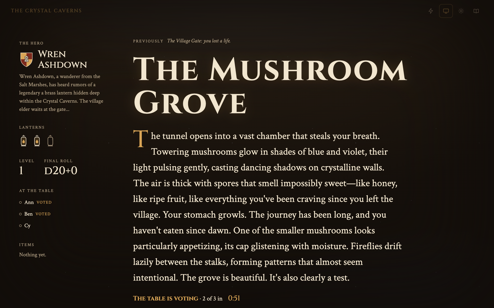
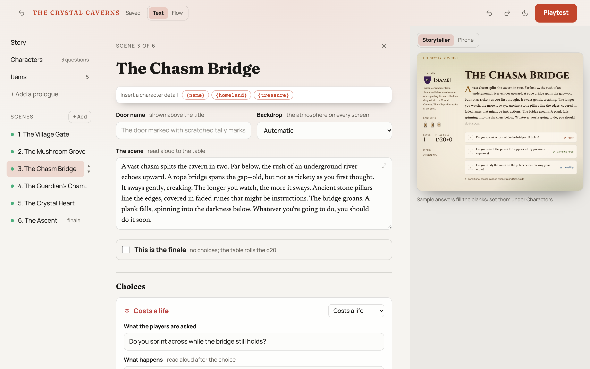
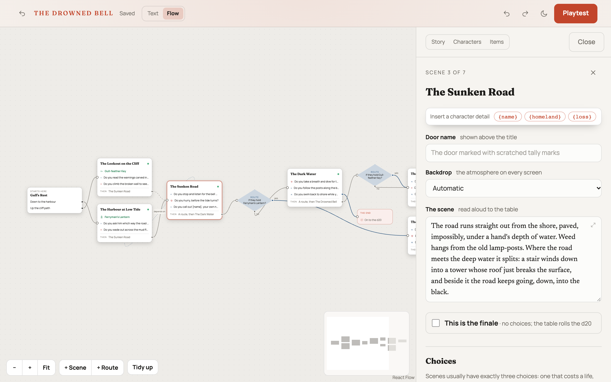
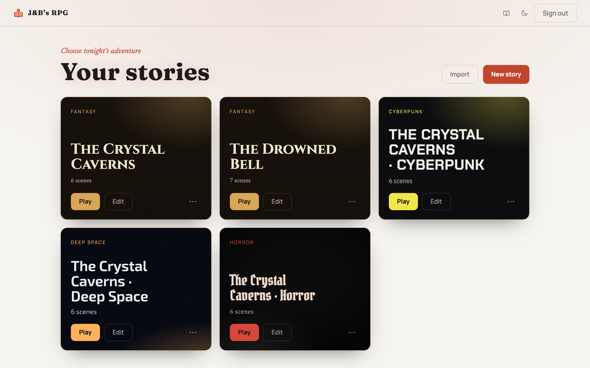

<p align="center">
  
</p>

<h1 align="center">J&amp;B’s RPG</h1>

<p align="center">
  <strong>Tell stories together.<br/>A storytelling game for the whole table: write and share your own adventures, then play them together, with the story on the big screen and every player choosing on their own phone. Self-hosted, no accounts, no cloud.</strong>
</p>

<p align="center">
  <a href="#why-jbs-rpg">Why</a> •
  <a href="#screenshots">Screenshots</a> •
  <a href="#features">Features</a> •
  <a href="#getting-started">Getting started</a> •
  <a href="docs/deployment.md">Deployment</a> •
  <a href="#architecture">Architecture</a>
</p>

<p align="center">
  <a href="https://github.com/brentonmallen1/jb-rpg/actions/workflows/ci.yml"></a>
  
  
  
  
  
</p>

---

## Why J&B’s RPG?

**It’s a game night, not a rules system.** The storyteller reads a scene aloud, the table argues
about what to do, and the choice plays out on every screen in the room. A few evenings of story,
three choices a scene, one hero the whole table builds together, and a real d20 rolled at the end.

1. **Build a hero together.** Players answer odd, sideways questions (“What would you name a
   friendly ghost?”) without knowing what they’re for. The answers become the hero.
2. **Play scene by scene.** Every choice costs a life, finds an item or levels the hero up, and
   nobody but the storyteller knows which until it’s made.
3. **Roll for the ending.** The finale is a physical d20: levels give extra rolls, items add
   bonuses, and the table finds out together.

### For the storyteller, a stage. For players, their phone.

- **The storyteller’s screen** holds the whole story: outcomes, progress, who has voted. Press
  `P` and it becomes a clean view for the TV, with nothing a player shouldn’t see.
- **Players just open a link.** No app, no sign-up. Their phone shows the scene, the choices, the
  hero’s health in the story’s own iconography, and the moments as they land. It never receives
  the story itself, so there is nothing to peek at.

### Self-hosted, private, yours.

- **One container, one folder.** Stories are plain JSON files you can export, import and keep in
  git. No database, no account anywhere else, no telemetry.
- **One login.** Only the storyteller signs in. Players join with the game’s private link, which
  stops working when the game ends.

## Screenshots

<p align="center">
  
  <br/><em>The storyteller’s stage in a voting game: outcomes and the table’s favourite are only on this screen.</em>
</p>

<p align="center">
  
  <br/><em>The same moment on players’ phones, in four of the six themes.</em>
</p>

<p align="center">
  
  <br/><em>Presentation mode, for the TV: the story, never the answers.</em>
</p>

<p align="center">
  <picture>
    <source media="(prefers-color-scheme: dark)" srcset="docs/images/screenshots/editor-dark.png" />
    
  </picture>
  <br/><em>The editor: write a scene and watch it on the stage or a phone as you type.</em>
</p>

<p align="center">
  <picture>
    <source media="(prefers-color-scheme: dark)" srcset="docs/images/screenshots/flow-dark.png" />
    
  </picture>
  <br/><em>The Flow view: draw where each choice leads, and see every branch at once.</em>
</p>

<p align="center">
  <picture>
    <source media="(prefers-color-scheme: dark)" srcset="docs/images/screenshots/library-dark.png" />
    
  </picture>
  <br/><em>The library: each story wears its theme.</em>
</p>

## Features

### Play

- **Four ways to choose**, picked when the game starts: the storyteller decides after the table
  talks; players take turns; the storyteller picks who decides; or **the table votes** on their
  phones against the clock. Votes only guide the storyteller, who sees the tally (ties flagged)
  and makes the call.
- **Moments** play on every screen at once: a life lost, an item found, a new scene, the finale,
  victory or defeat, each styled by the theme.
- **Undo** any choice; the game replays from its history.
- **Survives anything**: refreshes, dropped Wi-Fi, a server restart. State is written to disk on
  every change, and phones reconnect by themselves.
- **Players never know where they are** in the story, until the finale arrives.

### Atmosphere

- **Six themes**: Fantasy, Deep Space, Cyberpunk, Modern, Horror and Insanity, each with its own
  type, colours, health iconography (candles, hull shields, sight…) and backdrops.
- **Moods per scene**, or picked automatically: fog, storms, candlelight, nebulae.
- **Insanity** makes the text itself misbehave as sanity drains.
- **Sound**: upload ambience and stings per story; they play from the storyteller’s screen.
- **Calm when needed**: a whole-table *No flashing* switch, and each phone can choose Full,
  Gentle or Off. Reduced-motion settings are respected.

### Write

- **A visual editor**, no JSON: scenes you can drag into order, choices as cards, and a live
  preview on the stage or a phone.
- **Character questions** with presets to start from, and `{answers}` you can drop into any text.
- **Conditional text** that changes with health, items, level or earlier choices.
- **Problems flagged on the field** that needs fixing, before anyone sits down to play.
- **Playtest** the draft in one click; **duplicate**, **export** and **import** stories as JSON.

## Getting started

### With Docker

```bash
git clone https://github.com/brentonmallen1/jb-rpg.git && cd jb-rpg
docker compose up -d --build
```

Open <http://localhost:8000>. With no login configured, one is generated on first start: find it
with `docker compose logs` (it’s also saved in `data/admin.json`). Set `ADMIN_USER` and
`ADMIN_PASSWORD` in `.env` to choose your own. The demo story, *The Crystal Caverns*, is in the
library to try.

To play, press **Play** on a story, choose how the table makes choices, then share the player link
(the link icon on the stage).

Putting it on the internet so friends elsewhere can join: [docs/deployment.md](docs/deployment.md).

### Configuration

| Variable | Default | What it does |
|---|---|---|
| `BACKEND_PORT` | `8000` | The port the app listens on |
| `DATA_DIR` | `./data` (`/data` in Docker) | Stories, the running game, uploaded audio, the login |
| `ADMIN_USER` / `ADMIN_PASSWORD` | generated | The storyteller’s login |
| `AUTH_DISABLED` | `false` | `true` turns the login off: local development only |
| `BASE_URL` | the browser’s address | The public address used in player links, behind a reverse proxy |
| `MAX_STORY_MB` | `10` | The largest story the server takes, saved or imported (uploaded audio has its own 30 MB limit) |
| `ALLOWED_ORIGINS` | localhost | CORS origins, comma-separated (only needed for development setups) |

### Develop it

Requires [uv](https://docs.astral.sh/uv/), Node and [just](https://github.com/casey/just).

```bash
just install         # Python and frontend dependencies
just backend         # API on http://localhost:8000
just frontend-dev    # the app on http://localhost:5173, with hot reload
```

`just test` runs the backend tests, `just e2e` plays a storyteller and phones in real browsers,
and `just screenshots` regenerates the images above. CI runs pytest, eslint and the build.
Project conventions are in [CLAUDE.md](CLAUDE.md).

## Architecture

| Part | What |
|---|---|
| Backend | Python 3.13, FastAPI; pure game rules in `app/engine.py` |
| Storage | Flat JSON files: one per story, plus `state.json` for the game in progress |
| Live updates | Server-Sent Events: every change broadcasts to every screen, by role |
| Frontend | React 19, TypeScript, Vite; self-hosted fonts, no network needed at game time |
| Access | One storyteller login (a signed cookie), a per-game storyteller token, private player links |
| Deployment | One Docker image serving the API and the built app |

## License

[GPL-3.0](LICENSE).
